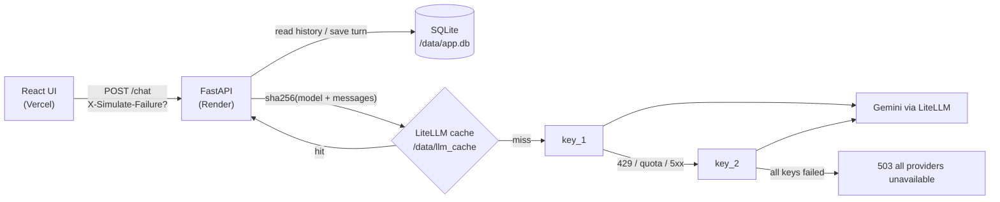

# Echo — LLM Chatbot with Key Failover and Response Caching

Echo is a full-stack AI chat app by **Ankit Notnani**, built for the Lyftr AI full-stack assignment.
React frontend · FastAPI backend · LiteLLM gateway (key pool + built-in cache) · SQLite session storage · Docker.

Every reply shows where it came from (`LIVE_INFERENCE` or `LLM_CACHE`), the model, the latency and that request's input/output tokens. When an API key is rate-limited or the provider errors, the backend fails over to the next key automatically; when every key fails, the user gets a clean, readable 503 instead of a broken screen.

---

## 1. Live URLs

| What | URL |
| --- | --- |
| Frontend | https://echo-chat.vercel.app *(replace after deploy)* |
| Backend | https://echo-api.onrender.com *(replace after deploy)* |
| Health | https://echo-api.onrender.com/health |
| Demo video | *(link)* |

> The backend runs on Render's free tier, which sleeps after ~15 minutes idle. The first request after that can take ~50 seconds; the UI shows "Waking up the server…" and retries automatically.

---

## 2. Run locally

### With Docker (one command)

Requirements: Docker Desktop (and `make`; on Windows `winget install ezwinports.make`).

```bash
cp .env.example .env        # then put your two API keys in LLM_API_KEYS
make up                     # backend http://localhost:8000, frontend http://localhost:3000
make down                   # stop (history stays in the app_data volume)
```

Without `make`: `docker compose up -d --build` and `docker compose down`.
Other targets: `make test` (backend tests in Docker), `make smoke` (contract checks), `make logs`, `make clean` (deletes the volume).

### Without Docker

Backend (Python 3.12):

```bash
cd backend
python -m venv .venv
# Windows: .venv\Scripts\activate      macOS/Linux: source .venv/bin/activate
pip install -r requirements-dev.txt
# reads the root .env (copied from .env.example; DATABASE_URL=sqlite:///./app.db)
uvicorn app.main:app --reload --port 8000 --env-file ../.env
pytest                       # 30+ tests, no network or API quota needed
```

Frontend (Node 20.19+):

```bash
cd frontend
npm install
# VITE_API_URL defaults to http://localhost:8000
npm run dev                  # http://localhost:3000
```

---

## 3. Design decisions



### Key fallback

- `LLM_API_KEYS` is an ordered pool; ids are `key_1`, `key_2`, … The real keys are never returned, logged or committed. Logs record only the key id, the error class and its status.
- The deployed pool: `key_1` and `key_2` are Gemini keys from two separate Google projects (independent quotas), and `key_3` is a Groq key on a different provider (`LLM_KEY_MODELS`). `model` in each response is the LiteLLM model of the key that actually answered.
- Each attempt is one `litellm.acompletion(...)` call with that key and `num_retries=0`. Failover is an explicit, deterministic loop in `backend/app/gateway.py`, so `key_id` and `fallback_attempts` are always exact.
- A key fails over on **429 / quota (`RateLimitError`) and every 5xx** (`InternalServerError`, `ServiceUnavailableError`, `APIError` 5xx), and also on timeouts, connection errors, auth errors (a revoked key) and empty replies, so the user never sees a broken screen.
- **No cooldowns:** a failure affects only the request it happened in. This matches the "for that one request only" rule of the test hook and keeps behaviour predictable.
- **`X-Simulate-Failure`** (honoured only when `ENABLE_FAILURE_SIMULATION=true`) makes listed keys raise the *same LiteLLM exception* a real provider failure would, inside the same `try/except`. The demo exercises the real failover path, not a separate code path. Statuses 429, 500, 502 and 503 are supported, `*` means every key, and an explicit pair overrides `*`.
- If every key fails, the API returns `503 {"detail": "all providers unavailable"}` and **writes nothing** to SQLite.

### Caching

- LiteLLM's built-in cache is enabled at startup: `litellm.cache = Cache(type="disk", disk_cache_dir="/data/llm_cache")`, falling back to `Cache(type="local")` (in-memory). No Redis.
- **Cache key = model + the full message list** (system prompt + history + new message), hashed with SHA-256. The API key is not part of it. So the same first message in a new session is a hit, while a different message, history or system prompt is always a miss.
- The gateway reads and writes this LiteLLM cache backend explicitly, before and after the key pool, instead of relying on `acompletion(caching=True)`. That keeps the `LLM_CACHE` / `LIVE_INFERENCE` label exact and independent of LiteLLM-internal response fields, which changed between LiteLLM versions during development.
- A live reply is stored together with its token usage and model. A hit returns the **identical reply** and the **stored tokens**, with `key_id: null` and `fallback_attempts: 0`. A hit never touches the network, so it takes a few ms against hundreds for a live call.
- **Simulated requests skip the cache *read* (they still write).** Otherwise a previously cached prompt would hide the failover the header asks to demonstrate (`key_1=429` must answer from `key_2`, and `*=429` must return 503).
- The disk cache lives on the same `/data` volume as the database, so it survives container restarts.

### SQLite session storage

- `DATABASE_URL` (e.g. `sqlite:////data/app.db`) points at a file on the `app_data` Docker volume. The schema is created on startup.
- `messages` matches the assignment's data model exactly (plus a CHECK on `role` and an index on `(session_id, id)`). A small `sessions` table stores the per-session `system_prompt` override.
- A turn (user row + assistant row with the metadata JSON + session upsert) is written in **one transaction, only after the LLM succeeded**, so 422 and 503 requests leave no trace.
- The client sends only the new message; the backend rebuilds the context from SQLite (most recent `MAX_HISTORY_MESSAGES`). WAL mode and short-lived connections keep it safe under FastAPI's thread pool.
- Note: Render's free tier has no persistent disk, so the *deployed* database resets on redeploy. The volume persistence required by the assignment is demonstrated with `make up` / `make down`.

### API hygiene

- Exactly three endpoints: `GET /health`, `POST /chat`, `GET /sessions/{session_id}/messages`. Swagger/OpenAPI are disabled unless `ENABLE_DOCS=true`.
- Every error is JSON with a `detail` field (422 validation, 503 all keys failed, 404 unknown session, 500 generic with no stack trace).
- CORS allows only `ALLOWED_ORIGINS` (plus optional `ALLOWED_ORIGIN_REGEX`), with methods `GET/POST/OPTIONS` and headers `Content-Type, X-Simulate-Failure`.

---

## 4. Verification

Replace `$API` with `http://localhost:8000` or the Render URL.

```bash
# health
curl $API/health

# live answer
curl -X POST $API/chat -H "Content-Type: application/json" \
  -d '{"session_id":"demo-1","message":"What is the capital of France?"}'

# cache hit: same first message, new session -> "LLM_CACHE", key_id null, lower latency_ms
curl -X POST $API/chat -H "Content-Type: application/json" \
  -d '{"session_id":"demo-2","message":"What is the capital of France?"}'

# failover: key_1 rate-limited -> 200 from key_2, fallback_attempts 1
curl -X POST $API/chat -H "Content-Type: application/json" -H "X-Simulate-Failure: key_1=429" \
  -d '{"session_id":"demo-3","message":"Say hello"}'

# every key fails -> 503 {"detail":"all providers unavailable"}, nothing saved
curl -X POST $API/chat -H "Content-Type: application/json" -H "X-Simulate-Failure: *=429" \
  -d '{"session_id":"demo-4","message":"Say hello"}'

# validation -> 422
curl -X POST $API/chat -H "Content-Type: application/json" -d '{"session_id":"demo-5","message":"   "}'

# history (oldest first) and unknown session (404)
curl $API/sessions/demo-1/messages
curl $API/sessions/nope/messages
```

All of the above in one go: `python scripts/smoke.py $API` (prints PASS/FAIL per check).

**In the UI:**

- **Per-message metadata:** every assistant reply has chips for `meta-source` (blue `LIVE_INFERENCE` / violet `LLM_CACHE`), `meta-model`, `meta-latency`, `meta-input-tokens` / `meta-output-tokens`, plus the key id and a "1 failover" chip when a fallback happened.
- **Cache hit:** click **+ → New chat** and send the same first message again.
- **Failover:** click **+** and pick *Fail key_1 · 429* (or 500/503) before sending. The reply shows `key_2` and "1 failover". *Fail all keys · 429* shows the readable 503 message with a Retry button.
- **Overview** tab: backend health and a per-request table (source, latency, tokens, key, failovers), with no running totals.

---

## 5. Setup Used

- **Editor:** Visual Studio Code on Windows.
- **AI tools:** Claude (Anthropic), used for architecture, code generation, tests and documentation, with every step reviewed and run locally by me.
- **Runtime:** Python 3.12, Node 22, Docker Desktop; deployed on Render (backend) and Vercel (frontend).

---

## 6. Bonus features

- **In-app failover demo** (the **+** menu): sends `X-Simulate-Failure` for the next message only, so failover can be shown without curl.
- **Live status pill:** polls `/health`, shows the number of keys in the pool and the model on hover, and goes grey when the backend is down.
- **Overview tab:** backend health plus a per-request metrics table with median live vs cache latency.
- **Response style and Deep Think menus, plus a custom system prompt** (`data-testid="system-prompt-input"`), sent as the optional `system_prompt` and stored per session.
- **Recent conversations:** kept in the browser and reopened through `GET /sessions/{id}/messages`. A new session still starts on every page load.
- **Cold-start resilience:** on a network error the UI waits for `/health` and retries once automatically.
- **Cross-provider failover:** `LLM_KEY_MODELS` gives each key its own model. The deployed pool is two Gemini keys from two separate Google accounts (`gemini-3.5-flash-lite`) plus one Groq key (`openai/gpt-oss-120b`), so even a full Gemini outage is survived. This came from testing: during development the newest Gemini Flash models returned `503 high demand` and timeouts for every key, and a single-provider pool would have failed every request.
- **Glass orb visual:** a procedurally rendered 4-second loop (`scripts/render_orb.py`), 36 KB WebM, CDN-cached, with a still-image fallback for reduced motion.
- **Quality:** 30+ backend tests (failover, cache, validation, history, CORS, persistence), a stdlib-only smoke script, a Playwright UI contract test, a `render.yaml` blueprint, non-root multi-stage images and markup-safe Markdown rendering.
